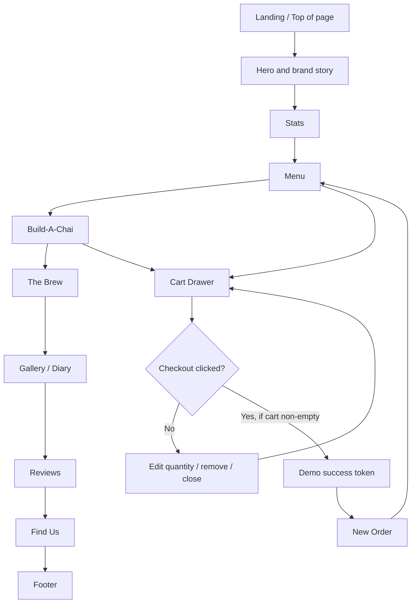
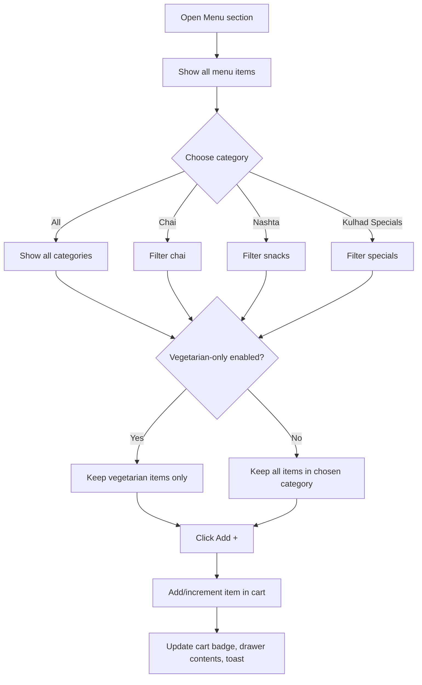
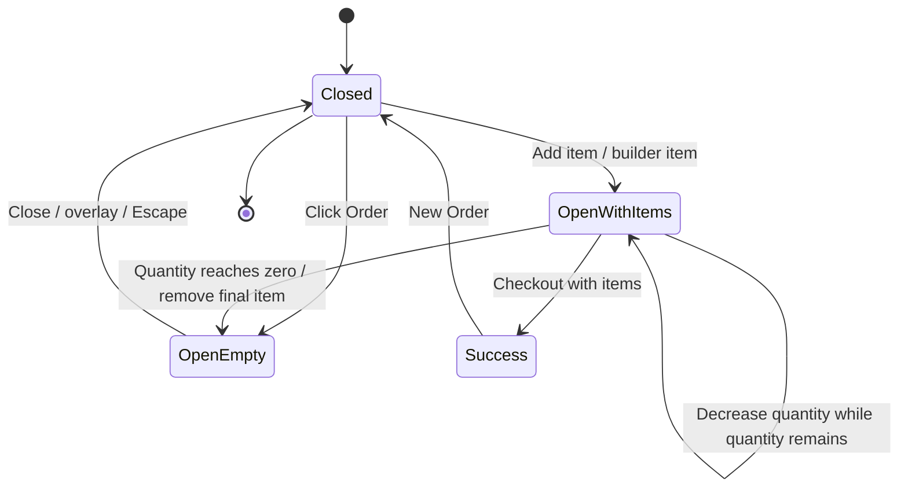

# Application Flow
## Tapri & Co. — Existing User Journeys and Interaction States

## 1. High-level page flow

## 2. Entry and navigation
1. User opens the single-page site.
2. Top ticker displays repeating brand messages.
3. Header exposes anchor navigation and order/cart button.
4. Hero presents the main message, visual steaming kulhad, and two calls to action.
5. The page continues vertically through stats, menu, builder, brewing story, gallery, reviews, location, and footer.
6. Anchor links should scroll to the matching section; do not replace this with unrelated route changes during the migration.

## 3. Menu flow

## 4. Build-A-Chai flow
1. User enters the builder section.
2. Defaults are preselected in the existing source.
3. User chooses vessel, milk type, kadak level, ginger, masala, sweetness, and optional top-ups.
4. Each change updates:
   - SVG cup fill level and tea color
   - Receipt line items
   - Strength label
   - Total price
5. User selects “Order mein daalo.”
6. A configured custom chai item is added to the cart with a configuration summary.
7. Cart drawer opens.

### Builder price components
- Vessel: Cutting / Kulhad / Bada Lagan
- Milk: Bhains Full-Cream / Toned / Badam Milk / Oat
- Strength: 1–5, with extra charge at level 5 in the source
- Ginger: none / regular / double
- Masala: skip / house blend / double
- Sweetness: no sugar / less / regular / extra gud
- Top-ups: malai / dry fruits / honey / extra kulhad

## 5. Cart flow

- Menu items use a stable item key so repeat additions increment the same item.
- Builder items are added as separate configured entries in the current source.
- Quantity controls update the badge and totals.
- Removing the final item returns to the empty state.
- Overlay, close button, and Escape should close the drawer.
- The current checkout is a demo-only client-side simulation; it creates a token and clears the cart without transmitting an order.

## 6. Loyalty punch-card flow
1. Ten punch slots are rendered.
2. Clicking a slot toggles its stamped state.
3. When every slot is stamped, the card enters the completed state and a toast announces a free chai.
4. Removing a stamp reverses the completed state.
5. State is browser-memory only; it does not persist or validate real purchases.

## 7. Reviews flow
- User reaches Reviews by scrolling.
- Previous/next controls horizontally scroll the review strip by a fixed distance.
- Reduced-motion mode uses non-smooth scrolling.

## 8. Hours and scroll effects
- The current weekday is highlighted in the hours table at runtime.
- Header style changes after scrolling beyond the current threshold.
- Reveal elements animate when they enter the viewport.
- Hero/heading text scramble and numeric count-up trigger when their elements enter the viewport.
- All observers/listeners/timers must be cleaned up correctly in the component implementation.

## 9. Error and edge states to preserve or define
- Empty cart: show existing empty-state message and hide checkout footer.
- Checkout with empty cart: do nothing.
- Quantity decreases to zero or below: remove the item.
- Reduced motion: avoid the text scramble and minimize/disable transitions while retaining visible content.
- Image load failure: browser should still show alt text/layout; do not let a missing image break the section.
- Real order submission failure is not applicable until an actual backend is implemented; if added later, introduce explicit loading, failure, retry, and success states.
